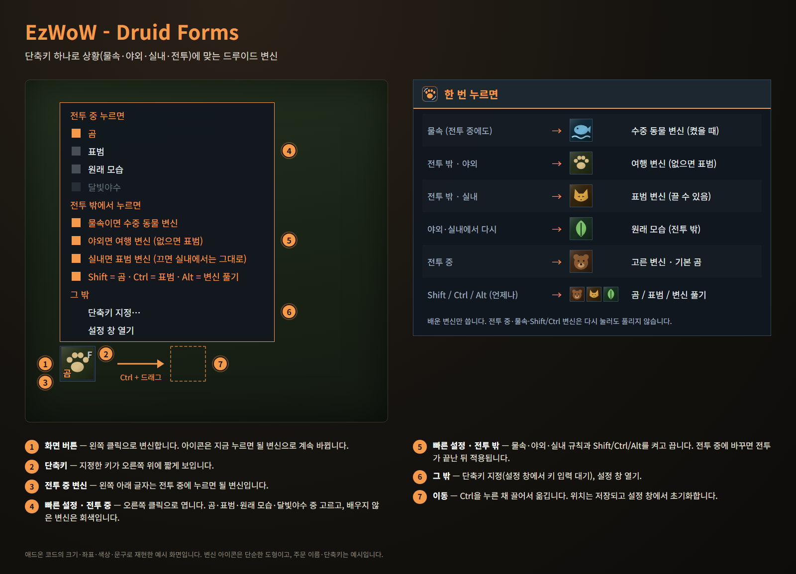
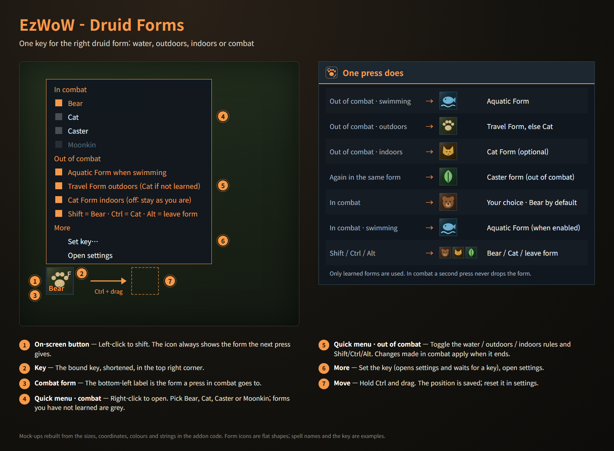

# EzWoW - Druid Forms

단축키 하나로 상황에 맞는 드루이드 변신을 합니다.
One key for the right druid form.

- 명령어 / Commands: `/ezdf`, `/드루이드`

## 한국어

> 이미지는 애드온 코드의 크기·좌표·색상·문구로 재현한 **예시 화면**입니다. 변신 아이콘은 단순한 도형이고, 주문 이름·단축키는 예시입니다.

| 상황 | 누르면 |
|---|---|
| 물속 (전투 중에도) | 수중 생물 변신 ("물속이면 수중 생물 변신"을 켰을 때). 이미 수중 생물이면 그대로 |
| 전투 밖 · 야외 | 날쌘 동물 변신 (없으면 표범) |
| 전투 밖 · 실내 | 표범 변신 (끌 수 있음) |
| 전투 밖 · 야외·실내에서 이미 그 변신 | 원래 모습 |
| 전투 중 | 고른 변신(곰 / 표범 / 원래 모습 / 달빛야수). 이미 그 변신이면 풀리지 않음 |
| Shift / Ctrl / Alt (언제나) | 곰 / 표범 / 변신 풀기. Shift·Ctrl은 이미 그 변신이면 그대로 유지 |

- **단축키**: 설정 창(`/ezdf`)에서 버튼을 누르고 쓸 키를 누르거나(Esc 취소, 마우스 휠·가운데·옆 버튼도 가능), 게임 단축키 설정의 "애드온" 항목에서 지정합니다. 그 키의 기존 동작이 바뀌거나, Shift/Ctrl + 그 키가 이미 다른 기능에 쓰이고 있으면 대화창에 알려 줍니다(그 조합으로는 곰/표범 변신이 동작하지 않습니다). 게임 설정의 "키를 누를 때 시전" 여부(누를 때 / 뗄 때)를 그대로 따릅니다.
- **화면 버튼**: 왼쪽 클릭으로 변신하고, 아이콘은 지금 누르면 될 변신을 보여 줍니다. 오른쪽 위는 단축키, 왼쪽 아래는 전투 중 변신입니다. 마우스를 올리면 단축키·전투 중 변신·규칙을 툴팁으로 보여 줍니다.
- **빠른 설정**: 화면 버튼을 오른쪽 클릭하면 전투 중 변신, 물속·야외·실내 규칙, 보조키를 바로 바꾸고, 단축키 지정이나 설정 창 열기로 갈 수 있습니다. 배우지 않은 변신은 회색입니다. 전투 중에 바꾸면 전투가 끝난 뒤 적용됩니다.
- **이동**: Ctrl을 누른 채 화면 버튼을 끌어서 옮깁니다. 설정 창에서 숨기기·크기(24~64)·위치 초기화를 할 수 있습니다.
- 변신 막대에 있는 **배운 변신만** 쓰므로 레벨에 따라 자동으로 맞춰집니다. 판단은 게임 매크로 조건으로 하므로 전투 중에도 동작하고, 설정 창에서 지금 쓰는 매크로를 볼 수 있습니다. 주문 이름이 길어 매크로가 한 번에 들어가지 않으면 자동으로 나눠 실행합니다.
- 드루이드가 아닌 캐릭터에서는 아무것도 하지 않습니다. 언어는 자동 + 8개 언어 중에서 고릅니다.

<!-- ezwow-pad-share -->
### 게임패드
- 게임패드 UI를 켜면 EzWoW 창을 패드로 다룰 수 있습니다. 방향키로 이동, A(✕)로 누르기, X(□)로 오른쪽 클릭, LB/RB로 스크롤, B(○)로 닫기입니다. 창 아래에 연결된 패드 모양으로 키 안내가 나옵니다.
- 블리자드 창이 열려 있지 않을 때 **보기(Back) / Create 버튼**을 누르면 화면의 EzWoW 프레임(유틸리티 바, 퀘스트 목록 등)으로 이동합니다. 다시 누르거나 B를 누르면 돌아갑니다.
- 다른 버튼을 쓰려면 설정 > 단축키 > 애드온 > EzWoW > "게임패드: EzWoW 창으로 이동/돌아가기"에 지정합니다(EzWoW-MapFinder가 설치돼 있을 때).

### 기록 공유
- 모든 EzWoW 애드온이 함께 쓰는 기록 공유가 **기본으로 켜져 있습니다**. 직접 확인한 퀘스트 NPC, 희귀 몬스터 목격, 아이템 드롭, 채집 위치를 다른 EzWoW 사용자와 나눕니다.
- `/ezshare` 또는 `/공유`: `on` / `off` 켜기·끄기, `channel on` / `channel off` 서버 채널 사용, `status` 현재 상태와 기록 수.

## English

> Mock-ups rebuilt from the sizes, coordinates, colours and strings in the addon code. Form icons are flat shapes; spell names and the key are examples.

| Situation | Press |
|---|---|
| Swimming (also in combat) | Aquatic Form (when "Aquatic Form when swimming" is on); already aquatic: it stays |
| Out of combat · outdoors | Travel Form (Cat if not learned) |
| Out of combat · indoors | Cat Form (optional) |
| Out of combat · outdoors/indoors, already in that form | Caster form |
| In combat | Your choice (Bear / Cat / Caster / Moonkin); pressing again never drops it |
| Shift / Ctrl / Alt, any time | Bear / Cat / leave form; Shift and Ctrl keep you in Bear or Cat if you are already in it |

- **Key**: in settings (`/ezdf`) click the key button and press a key (Esc cancels; mouse wheel, middle and side buttons work too), or use the game's Key Bindings ("AddOns"). Chat tells you when the key's old action is replaced, or when Shift/Ctrl + that key is already bound elsewhere (those combinations then won't shift to Bear/Cat). The game's "cast on key down" setting is followed.
- **On-screen button**: left-click to shift; the icon shows what the next press does. Top right: the key. Bottom left: the combat form. Hover for a tooltip with the key, the combat form and the rules.
- **Quick menu**: right-click the button to change the combat form, the water / outdoors / indoors rules and the modifiers, or jump to setting the key or opening settings. Forms you have not learned are grey. Changes made in combat apply when it ends.
- **Move**: hold Ctrl and drag the button. Hide it, resize it (24–64) or reset its position in settings.
- Only forms on your stance bar are used, so it follows your level. The game's macro conditions make the choice, so it works in combat; settings show the current macro. When long spell names make the macro too long for one button, it is split up and run in parts automatically.
- Does nothing on characters that are not druids. Language: automatic or one of 8 languages.

### Gamepad
- With the gamepad UI on, EzWoW windows work with a gamepad: D-pad to move, A (✕) to press, X (□) for right-click, LB/RB to scroll, B (○) to close. A key guide in your pad's button style shows under the window.
- With no game window open, press **View (Back) / Create** to move to the EzWoW frames on screen (Utility Bar, quest list and more). Press it again or B to go back.
- To use another button, set Key Bindings > AddOns > EzWoW > "Gamepad: move to / leave the EzWoW frames" (with EzWoW-MapFinder installed).

### Record sharing
- Record sharing, used by all EzWoW addons, is **on by default**. Quest NPCs, rare monster sightings, item drops and gathering spots you have seen yourself are shared with other EzWoW users.
- `/ezshare`: `on` / `off` to turn it on or off, `channel on` / `channel off` for the server channel, `status` for the current state and record counts.

---

## Support / 후원

If you find this addon useful, you can support its development.

애드온이 도움이 되셨다면 개발 후원으로 응원해 주세요.

[Buy Me a Coffee ☕](https://buymeacoffee.com/qqhrqqhr2)

