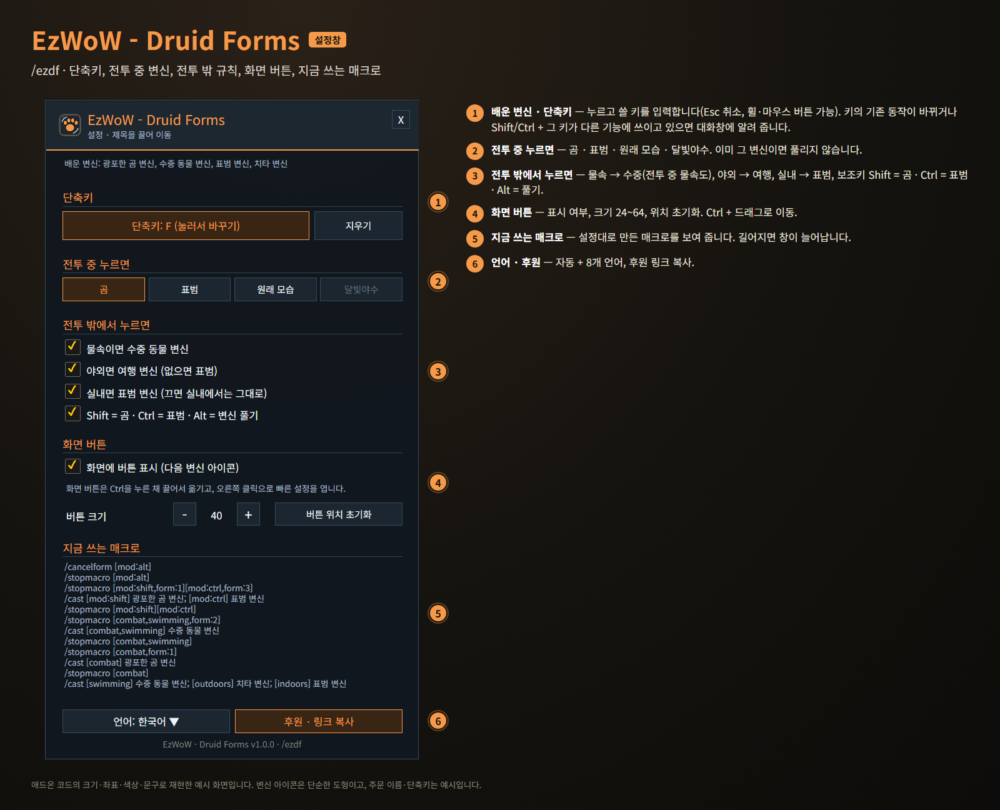
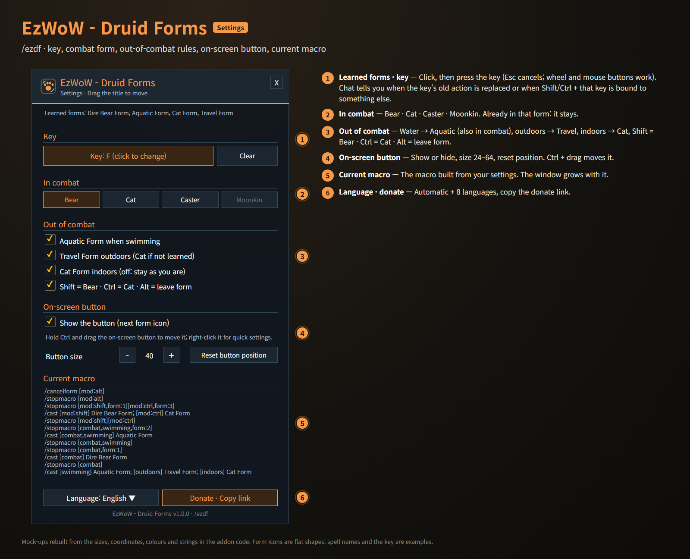

# EzWoW - Druid Forms

단축키 하나로 상황에 맞는 드루이드 변신을 합니다.
One key for the right druid form.

- 명령어 / Commands: `/ezdf`, `/드루이드`

## 한국어

> 이미지는 애드온 코드의 크기·좌표·색상·문구로 재현한 **예시 화면**입니다. 변신 아이콘은 단순한 도형이고, 주문 이름·단축키는 예시입니다.

| 상황 | 누르면 |
|---|---|
| 전투 밖 · 물속 | 수중 동물 변신 |
| 전투 밖 · 야외 | 여행 변신 (없으면 표범) |
| 전투 밖 · 실내 | 표범 변신 (끌 수 있음) |
| 전투 밖 · 이미 그 변신 | 원래 모습 |
| 전투 중 | 고른 변신(곰 / 표범 / 원래 모습 / 달빛야수). 이미 그 변신이면 풀리지 않음 |
| 전투 중 · 물속 | 수중 동물 변신 ("물속이면 수중 동물 변신"을 켰을 때) |
| Shift / Ctrl / Alt | 곰 / 표범 / 변신 풀기 |

- **단축키**: 설정 창(`/ezdf`)에서 버튼을 누르고 쓸 키를 누르거나, 게임 단축키 설정의 "애드온" 항목에서 지정합니다. 그 키의 기존 동작이 바뀌거나, Shift/Ctrl + 그 키가 이미 다른 기능에 쓰이고 있으면 대화창에 알려 줍니다(그 조합으로는 곰/표범 변신이 동작하지 않습니다).
- **화면 버튼**: 왼쪽 클릭으로 변신하고, 아이콘은 지금 누르면 될 변신을 보여 줍니다. 오른쪽 위는 단축키, 왼쪽 아래는 전투 중 변신입니다.
- **빠른 설정**: 화면 버튼을 오른쪽 클릭하면 전투 중 변신, 물속·야외·실내 규칙, 보조키를 바로 바꿀 수 있습니다. 전투 중에 바꾸면 전투가 끝난 뒤 적용됩니다.
- **이동**: Ctrl을 누른 채 화면 버튼을 끌어서 옮깁니다. 설정 창에서 숨기기·크기·위치 초기화를 할 수 있습니다.
- 변신 막대에 있는 **배운 변신만** 쓰므로 레벨에 따라 자동으로 맞춰집니다. 판단은 게임 매크로 조건으로 하므로 전투 중에도 동작하고, 설정 창에서 지금 쓰는 매크로를 볼 수 있습니다.

## English

> Mock-ups rebuilt from the sizes, coordinates, colours and strings in the addon code. Form icons are flat shapes; spell names and the key are examples.

| Situation | Press |
|---|---|
| Out of combat · swimming | Aquatic Form |
| Out of combat · outdoors | Travel Form (Cat if not learned) |
| Out of combat · indoors | Cat Form (optional) |
| Out of combat · already in that form | Caster form |
| In combat | Your choice (Bear / Cat / Caster / Moonkin); pressing again never drops it |
| In combat · swimming | Aquatic Form (when "Aquatic Form when swimming" is on) |
| Shift / Ctrl / Alt | Bear / Cat / leave form |

- **Key**: in settings (`/ezdf`) click the key button and press a key, or use the game's Key Bindings ("AddOns"). Chat tells you when the key's old action is replaced, or when Shift/Ctrl + that key is already bound elsewhere (those combinations then won't shift to Bear/Cat).
- **On-screen button**: left-click to shift; the icon shows what the next press does. Top right: the key. Bottom left: the combat form.
- **Quick menu**: right-click the button to change the combat form, the water / outdoors / indoors rules and the modifiers. Changes made in combat apply when it ends.
- **Move**: hold Ctrl and drag the button. Hide it, resize it or reset its position in settings.
- Only forms on your stance bar are used, so it follows your level. The game's macro conditions make the choice, so it works in combat; settings show the current macro.
