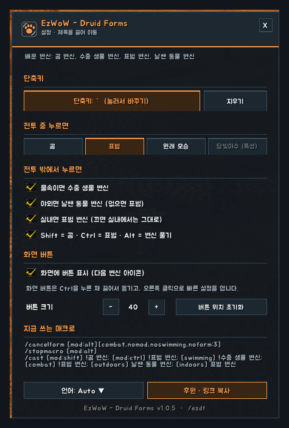
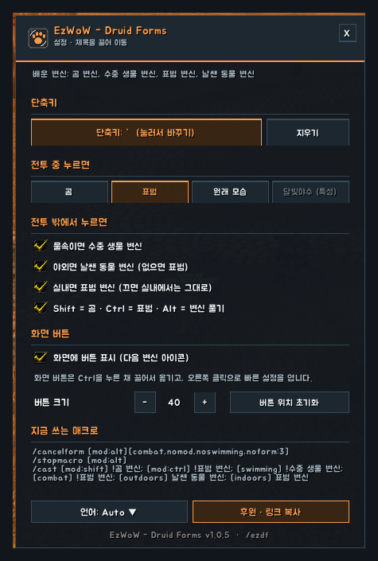

<!--
CurseForge summary (EN): One key for the right druid form: Aquatic in water, Travel outdoors, Cat indoors and your choice in combat, with an on-screen button.
CurseForge summary (KO): 단축키 하나로 물속은 수중 생물, 야외는 날쌘 동물, 실내는 표범, 전투 중에는 고른 변신. 화면 버튼과 빠른 설정 포함.
-->

# EzWoW - Druid Forms

**English** · [한국어](#한국어)

One key for the right druid form in WoW Forever: Aquatic Form in water, Travel Form outdoors, Cat Form indoors and the form of your choice in combat. Only the forms you have learned are used, so it follows your level. An on-screen button shows what the next press does.

*In-game screenshots (WoW Forever, Korean client). Character and player names and chat text are blurred.*

## Features

### One key
- **Swimming** (also in combat): Aquatic Form, if enabled. Already aquatic: it stays.
- **Out of combat, outdoors**: Travel Form (Cat Form if not learned yet).
- **Out of combat, indoors**: Cat Form (can be turned off to stay as you are).
- **Press again outdoors or indoors**: back to caster form.
- **In combat**: Bear, Cat, Caster or Moonkin, your choice (Bear by default). Pressing again never drops the form; from another form it changes in one press.
- **Modifiers** (any time, can be turned off): Shift = Bear, Ctrl = Cat, Alt = leave form. Shift and Ctrl keep you in the form if you are already in it.
- The choice is made by the game's macro conditions, so it works in combat. The settings show the current macro; a macro too long for one button (long spell names) is split up and run in parts automatically.

### Key binding
- Click the key button in the settings and press a key: keyboard keys, mouse wheel, middle and side mouse buttons. Esc cancels.
- Or bind it in the game's Key Bindings under "AddOns".
- Chat tells you when the key's old action is replaced, and when Shift/Ctrl + that key is already bound to something else (Bear/Cat then won't work with it).
- Follows the game's "cast on key down" setting.

### On-screen button
- Left-click to shift. The icon shows the form the next press gives.
- The key in the top right corner, the combat form in the bottom left.
- Hover for a tooltip with the key, the combat form and the rules.
- Ctrl + drag to move. Show or hide, size 24–64 and reset position in the settings.

### Quick menu
- Right-click the on-screen button: pick the combat form, toggle the water / outdoors / indoors rules and the modifiers, set the key or open the settings.
- Forms you have not learned are grey, with the level (or talent) that teaches them. Changes made in combat apply as soon as it ends.

## Gamepad
- With the gamepad UI on, EzWoW windows work with a gamepad: D-pad to move, A (✕) to press, X (□) for right-click, LB/RB to scroll, B (○) to close. A key guide in your pad's button style shows under the window.
- With no game window open, press **View (Back) / Create** to move to the EzWoW frames on screen. Press it again or B to go back.
- To use another button: Key Bindings > AddOns > EzWoW > "Gamepad: move to / leave the EzWoW frames" (with EzWoW-MapFinder installed).

## Record sharing
- Shared by all EzWoW addons and **on by default**: quest NPCs, rare monster sightings, item drops and gathering spots you have seen yourself are shared with other EzWoW users.
- `/ezshare on` / `off`, `/ezshare channel on` / `off`, `/ezshare status`

## Commands
- `/ezdf` or `/드루이드` — open the settings

Druids only; nothing happens on other classes.

Languages: English, 한국어, Deutsch, Français, Español, Русский, 简体中文, 繁體中文.

---

## 한국어

WoW Forever용 드루이드 변신 애드온입니다. 단축키 하나로 물속에서는 수중 생물 변신, 야외에서는 날쌘 동물 변신, 실내에서는 표범 변신, 전투 중에는 고른 변신을 합니다. 배운 변신만 쓰므로 레벨에 따라 자동으로 맞춰지고, 화면 버튼이 지금 누르면 될 변신을 보여 줍니다.

*실제 게임 화면입니다(WoW Forever, 한국어 클라이언트). 캐릭터 · 다른 플레이어 이름과 채팅 내용은 가렸습니다.*

## 기능

### 단축키 하나로
- **물속** (전투 중에도): 수중 생물 변신(켰을 때). 이미 수중 생물이면 그대로.
- **전투 밖 · 야외**: 날쌘 동물 변신(아직 없으면 표범).
- **전투 밖 · 실내**: 표범 변신(끄면 실내에서는 그대로).
- **야외·실내에서 다시 누르면**: 원래 모습.
- **전투 중**: 곰 · 표범 · 원래 모습 · 달빛야수 중 고른 변신(기본 곰). 다시 눌러도 풀리지 않고, 다른 변신 중이어도 한 번에 바뀝니다.
- **보조키** (언제나, 끌 수 있음): Shift = 곰, Ctrl = 표범, Alt = 변신 풀기. Shift·Ctrl은 이미 그 변신이면 그대로 유지합니다.
- 판단은 게임 매크로 조건으로 하므로 전투 중에도 동작합니다. 설정 창에서 지금 쓰는 매크로를 볼 수 있고, 주문 이름이 길어 매크로가 한 번에 들어가지 않으면 자동으로 나눠 실행합니다.

### 단축키 지정
- 설정 창에서 단축키 버튼을 누르고 쓸 키를 누릅니다. 키보드, 마우스 휠, 가운데·옆 버튼 모두 가능하고 Esc는 취소입니다.
- 게임 단축키 설정의 "애드온" 항목에서도 지정할 수 있습니다.
- 그 키의 기존 동작이 바뀌거나, Shift/Ctrl + 그 키가 이미 다른 기능에 쓰이고 있으면 대화창에 알려 줍니다(그 조합으로는 곰/표범 변신이 동작하지 않습니다).
- 게임 설정의 "키를 누를 때 시전" 여부를 그대로 따릅니다.

### 화면 버튼
- 왼쪽 클릭으로 변신합니다. 아이콘은 지금 누르면 될 변신으로 바뀝니다.
- 오른쪽 위에 단축키, 왼쪽 아래에 전투 중 변신을 표시합니다.
- 마우스를 올리면 단축키·전투 중 변신·규칙을 툴팁으로 보여 줍니다.
- Ctrl + 드래그로 이동. 설정 창에서 표시 여부, 크기(24~64), 위치 초기화.

### 빠른 설정
- 화면 버튼을 오른쪽 클릭하면 전투 중 변신, 물속·야외·실내 규칙, 보조키를 바로 바꾸고 단축키 지정이나 설정 창 열기로 갈 수 있습니다.
- 배우지 않은 변신은 회색이고, 옆에 배우는 레벨(또는 특성)이 나옵니다. 전투 중에 바꾸면 전투가 끝나는 대로 적용됩니다.

## 게임패드
- 게임패드 UI를 켜면 EzWoW 창을 패드로 다룰 수 있습니다. 방향키로 이동, A(✕)로 누르기, X(□)로 오른쪽 클릭, LB/RB로 스크롤, B(○)로 닫기입니다. 창 아래에 연결된 패드 모양으로 키 안내가 나옵니다.
- 블리자드 창이 열려 있지 않을 때 **보기(Back) / Create 버튼**을 누르면 화면의 EzWoW 프레임으로 이동합니다. 다시 누르거나 B를 누르면 돌아갑니다.
- 다른 버튼을 쓰려면: 설정 > 단축키 > 애드온 > EzWoW > "게임패드: EzWoW 창으로 이동/돌아가기" (EzWoW-MapFinder 설치 시)

## 기록 공유
- 모든 EzWoW 애드온이 함께 쓰며 **기본으로 켜져 있습니다**. 직접 확인한 퀘스트 NPC, 희귀 몬스터 목격, 아이템 드롭, 채집 위치를 다른 EzWoW 사용자와 나눕니다.
- `/ezshare on` / `off` (또는 `/공유`), `/ezshare channel on` / `off`, `/ezshare status`

## 명령어
- `/ezdf` 또는 `/드루이드` — 설정창 열기

드루이드 전용입니다. 다른 직업에서는 아무것도 하지 않습니다.

지원 언어: English, 한국어, Deutsch, Français, Español, Русский, 简体中文, 繁體中文.

---

**Support:** If you find this addon useful, you can support its development. [Buy Me a Coffee ☕](https://buymeacoffee.com/qqhrqqhr2)

**후원:** 애드온이 도움이 되셨다면 개발 후원으로 응원해 주세요. [Buy Me a Coffee ☕](https://buymeacoffee.com/qqhrqqhr2)
